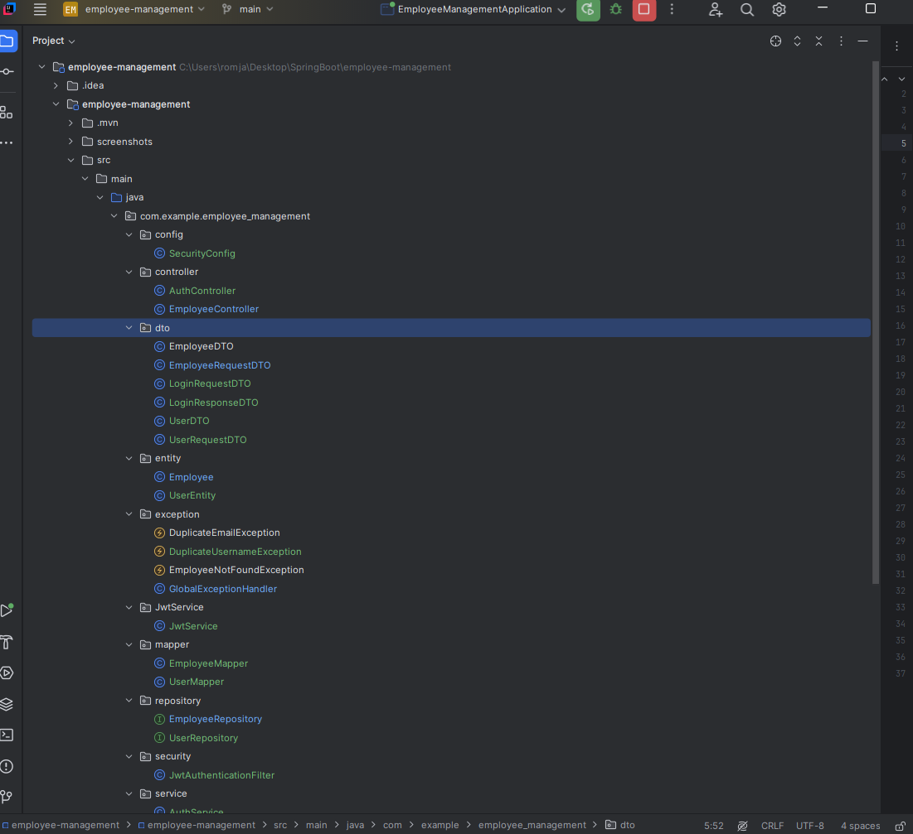
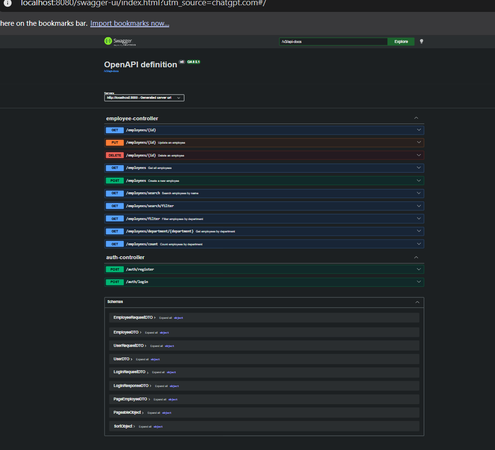
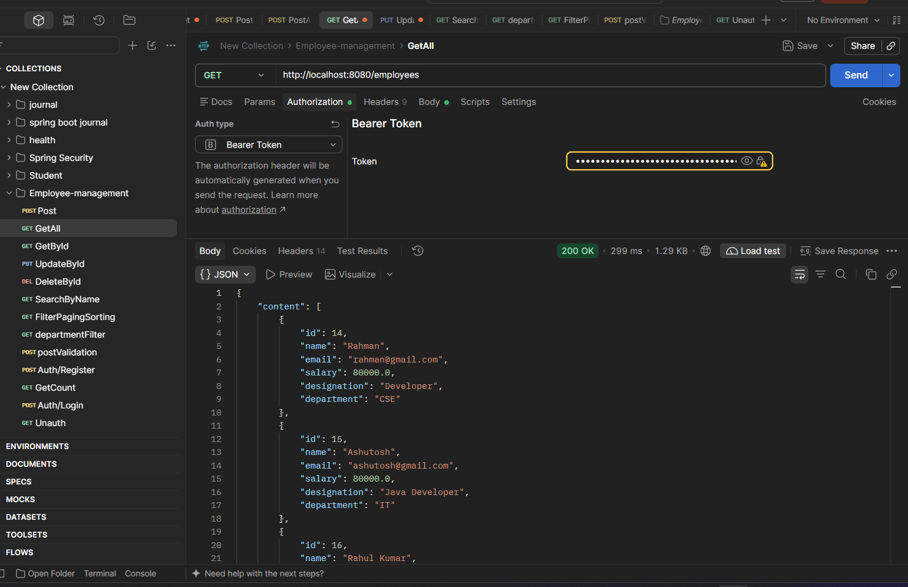
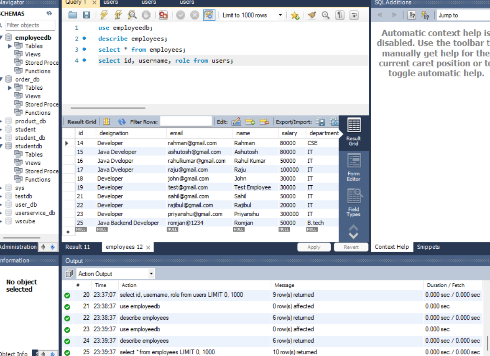
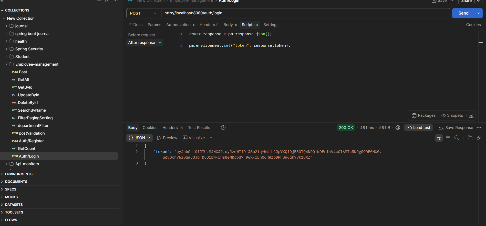

# 🚀 WorkForceX – Employee Management System

<p align="center">
  <strong>A Secure & Scalable Employee Management REST API</strong>
  <br>
  Built with Java 21, Spring Boot, Spring Security, JWT and MySQL.
</p>

<p align="center">
  
  
  
  
  
</p>

---

## 📌 About the Project

**WorkForceX** is a Java-based Employee Management System developed using Spring Boot. It provides RESTful APIs to manage employee information with secure authentication and role-based authorization.

The application allows users to register, log in, retrieve employee records, search employees, filter by department, and perform administrative operations.

The project follows a layered architecture to maintain separation of concerns, readability, and maintainability.

## ✨ Key Features

- 🔐 JWT-based authentication
- 👥 User registration and login
- 🛡️ Role-based authorization using Spring Security
- ➕ Create employee records
- 📋 Retrieve all employees with pagination and sorting
- 🔍 Search employees by name
- 🏢 Filter employees by department
- ✏️ Update employee information
- 🗑️ Delete employee records
- 📊 Count employees by department
- ✅ Input validation using Jakarta Validation
- ⚠️ Centralized exception handling
- 📖 Interactive API documentation using Swagger UI
- 🌐 CORS configuration for frontend integration

## 🛠️ Tech Stack

| Technology | Purpose |
|---|---|
| Java 21 | Backend programming |
| Spring Boot | Application framework |
| Spring Web | REST API development |
| Spring Data JPA | Database operations |
| Spring Security | Authentication and authorization |
| JWT | Token-based authentication |
| MySQL | Relational database |
| Hibernate | ORM |
| Maven | Dependency management |
| Jakarta Validation | Request validation |
| SpringDoc OpenAPI | Swagger API documentation |
| Postman | API testing |
| IntelliJ IDEA | Development environment |

## 🏗️ Project Architecture

The application follows a layered architecture:

```text
Client (Postman / Frontend)
          |
          v
     Controller Layer
          |
          v
      Service Layer
          |
          v
     Repository Layer
          |
          v
       MySQL Database
```

### Main Layers

- **Controller:** Handles incoming HTTP requests and returns API responses.
- **Service:** Contains business logic and application operations.
- **Repository:** Performs database operations using Spring Data JPA.
- **Entity:** Represents database tables.
- **DTO:** Transfers data between the client and application.
- **Security:** Handles JWT authentication and authorization.
- **Exception:** Handles application errors centrally.
- **Mapper:** Converts entities into DTOs and vice versa.

## 📂 Project Structure

```text
employee-management/
│
├── src/
│   ├── main/
│   │   ├── java/com/example/employee_management/
│   │   │   │
│   │   │   ├── config/
│   │   │   ├── controller/
│   │   │   ├── dto/
│   │   │   ├── entity/
│   │   │   ├── exception/
│   │   │   ├── mapper/
│   │   │   ├── repository/
│   │   │   ├── security/
│   │   │   ├── service/
│   │   │   │
│   │   │   └── EmployeeManagementApplication.java
│   │   │
│   │   └── resources/
│   │       └── application.properties
│   │
│   └── test/
│
├── screenshots/
│
├── pom.xml
└── README.md
```

## ⚙️ Getting Started

Follow these steps to run the project locally.

### 1. Prerequisites

Install the following:

- Java JDK 21
- Maven
- MySQL Server
- IntelliJ IDEA or another Java IDE
- Postman (optional, for API testing)

### 2. Clone the Repository

```bash
git clone https://github.com/RomjanAli0266/WorkForceX-Employee_Management_System.git
```

### 3. Open the Project

Open the `employee-management` folder in IntelliJ IDEA.

### 4. Create the MySQL Database

```sql
CREATE DATABASE employeedb;
```

### 5. Configure Environment Variables

The application uses environment variables for sensitive configuration.

Configure these variables before running the application:

```text
DB_PASSWORD=your_mysql_password
JWT_SECRET=your_base64_encoded_256_bit_secret
```

Do not commit actual database passwords or JWT secrets to GitHub.

### 6. Configure application.properties

Example configuration:

```properties
spring.application.name=employee-management

spring.datasource.url=jdbc:mysql://localhost:3306/employeedb
spring.datasource.username=root
spring.datasource.password=${DB_PASSWORD}

spring.jpa.hibernate.ddl-auto=update
spring.jpa.show-sql=true

jwt.secret=${JWT_SECRET}
```

Keep any additional configuration required by your local environment.

### 7. Run the Application

Using Maven:

```bash
mvn spring-boot:run
```

Or run `EmployeeManagementApplication.java` from IntelliJ IDEA.

The application runs at:

```text
http://localhost:8080
```

## 🔐 Authentication

WorkForceX uses Spring Security and JSON Web Tokens (JWT) for authentication.

### 1. Register a User

**Endpoint:**

```http
POST /auth/register
```

**Request Body:**

```json
{
  "username": "testuser",
  "password": "password123"
}
```

**Response:**

```json
{
  "id": 1,
  "username": "testuser",
  "role": "USER"
}
```

Newly registered users receive the default `USER` role.

### 2. Login

**Endpoint:**

```http
POST /auth/login
```

**Request Body:**

```json
{
  "username": "testuser",
  "password": "password123"
}
```

**Response:**

```json
{
  "token": "your_jwt_token"
}
```

### 3. Authorize API Requests

For protected endpoints, include the JWT in the HTTP request header:

```http
Authorization: Bearer your_jwt_token
```

Passwords are encoded using BCrypt before being stored in the database.

## 👥 Employee Management APIs

Base URL:

```text
http://localhost:8080
```

| Method | Endpoint | Description | Access |
|---|---|---|---|
| POST | `/employees` | Create employee | ADMIN |
| GET | `/employees` | Get all employees | USER / ADMIN |
| GET | `/employees/{id}` | Get employee by ID | USER / ADMIN |
| PUT | `/employees/{id}` | Update employee | ADMIN |
| DELETE | `/employees/{id}` | Delete employee | ADMIN |
| GET | `/employees/search` | Search by name | Authenticated |
| GET | `/employees/search/filter` | Search by name and department | Authenticated |
| GET | `/employees/filter` | Filter by department | Authenticated |
| GET | `/employees/department/{department}` | Get employees by department | Authenticated |
| GET | `/employees/count` | Count employees by department | Authenticated |

**Note:** The global security configuration requires authentication for all employee endpoints. The explicitly annotated endpoints also enforce the listed role restrictions.

## 📝 Employee Request Example

```http
POST /employees
```

**Request Body:**

```json
{
  "name": "Rahul Kumar",
  "email": "rahul@example.com",
  "salary": 45000.0,
  "designation": "Software Developer",
  "department": "IT"
}
```

**Response Example:**

```json
{
  "id": 1,
  "name": "Rahul Kumar",
  "email": "rahul@example.com",
  "salary": 45000.0,
  "designation": "Software Developer",
  "department": "IT"
}
```

## 📄 Pagination and Sorting

The employee listing API supports pagination and sorting.

**Example:**

```http
GET /employees?page=0&size=5&sortBy=name&direction=asc
```

| Parameter | Description | Example |
|---|---|---|
| page | Page number (starts from 0) | 0 |
| size | Number of records per page | 5 |
| sortBy | Field used for sorting | name |
| direction | Sorting direction | asc / desc |

Supported sorting fields include:

- id
- name
- email
- salary
- designation
- department

## 🔎 Search and Filtering

WorkForceX provides APIs for searching and filtering employee records.

**Search by employee name:**

```http
GET /employees/search?name=Rahul
```

**Filter by department:**

```http
GET /employees/filter?department=IT
```

**Search by name and department:**

```http
GET /employees/search/filter?name=Rahul&department=IT
```

**Get employees by department:**

```http
GET /employees/department/IT
```

**Count employees by department:**

```http
GET /employees/count?department=IT
```

## 🛡️ Security Features

- JWT-based stateless authentication.
- BCrypt password encoding.
- Spring Security authorization.
- Role-based access restrictions for administrative operations.
- Protected employee APIs.
- Environment-based configuration for sensitive values.
- CORS configuration for frontend communication.
- JWT validation through a custom authentication filter.

## ⚠️ Validation and Exception Handling

The application uses Jakarta Validation to validate employee and user request data.

Employee validation includes:

- Name is required.
- Email is required and must be valid.
- Salary is required and must be greater than zero.
- Designation is required.
- Department is required.

A centralized exception handler manages application errors such as:

- Employee not found.
- Duplicate employee email.
- Duplicate username.
- Invalid request data.
- Invalid pagination or sorting input.

## 📖 API Documentation – Swagger UI

WorkForceX integrates SpringDoc OpenAPI for interactive API documentation.

After starting the application, open:

```text
http://localhost:8080/swagger-ui/index.html
```

Swagger UI allows you to:

- Explore available REST endpoints.
- View request and response schemas.
- Test API operations.
- Authorize protected endpoints using a JWT Bearer token.

Use the **Authorize** button to enter your JWT token when testing protected employee endpoints.

OpenAPI JSON documentation:

```text
http://localhost:8080/v3/api-docs
```

## 🧪 API Testing

The APIs can be tested using Postman or Swagger UI.

Suggested testing workflow:

1. Register a new user.
2. Log in to receive a JWT token.
3. Authorize protected requests using the token.
4. Test employee retrieval and search APIs.
5. Test employee creation and modification using an ADMIN account.
6. Verify validation and exception responses.

## 🖥️ Project Screenshots

### 1. Project Structure



### 2. Swagger UI



### 3. Postman API Testing



### 4. MySQL Database



### 5. JWT Authentication



## 🚀 Future Enhancements

- Unit and integration testing.
- Docker containerization.
- Improved API response documentation.
- Logging and monitoring.
- Deployment to a cloud platform.
- Further frontend integration.

## 👨‍💻 Developer

**Romjan Ali**

B.Tech – Computer Science and Engineering

Interested in Java Backend Development, Spring Boot, REST APIs and Microservices.

- GitHub: [RomjanAli0266](https://github.com/RomjanAli0266)
- Project Repository: [WorkForceX – Employee Management System](https://github.com/RomjanAli0266/WorkForceX-Employee_Management_System)

---

<p align="center">
  <strong>Built with Java and Spring Boot ❤️</strong>
</p>
